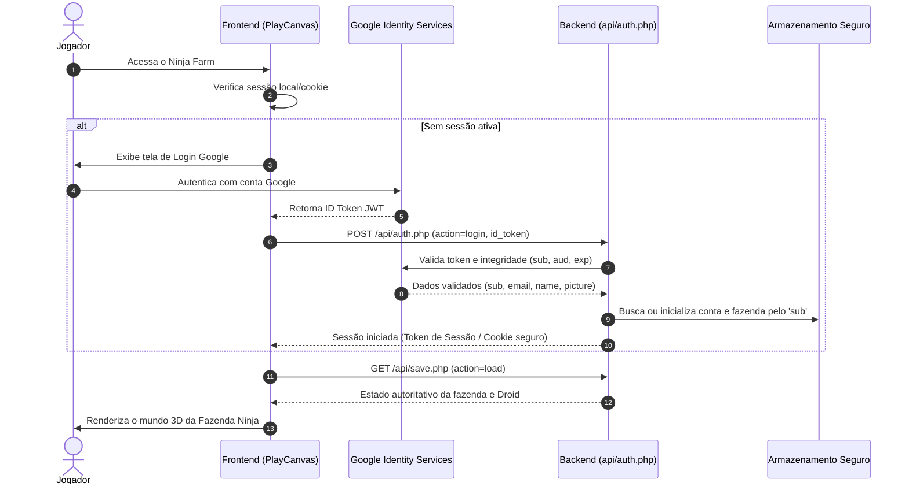

# Sistema de Droid Único, Agendador AFK, Google Auth e Nuvem

Este documento estabelece a arquitetura oficial do Ninja Farm para o Droid operacional único, agendamento de tarefas, simulação AFK (offline), autenticação Google e persistência autoritativa no backend.

---

## 1. O Papel do Ninja vs. O Papel do Droid

No Ninja Farm:

- **O Jogador (Ninja):** É o arquiteto, estrategista e gestor da base. Explora o mundo, seleciona objetos, define preferências de cultivo, posiciona blueprints no terreno, gerencia o inventário, negocia com o mercador e lidera missões externas.
- **O Droid Único:** É a única unidade robótica humanoide da propriedade. Ele executa fisicamente todo o trabalho manual e de infraestrutura:
    - Preparo de solo (arar e adubar).
    - Semeadura e rega manual de canteiros.
    - Colheita e transporte da produção para o celeiro.
    - Alimentação e cuidados da fauna (galinhas, vacas, peixes).
    - Construção física e acabamento de edifícios a partir de blueprints.
    - Manutenção e reparo de estruturas danificadas.
    - Recarga de bateria na estação da base.

> [!IMPORTANT]
> **Regra do Droid Único:** Cada fazenda possui estritamente **um** Droid. Não é permitido construir, adquirir ou spawnar unidades robóticas adicionais. O Droid executa **uma única tarefa física por vez**.

---

## 2. Autenticação Obrigatória Google & Sessão Segura

O acesso à fazenda exige autenticação via **Google Identity Services (GIS)**.

### Princípios de Segurança da Identidade

1. **Identificador Imutável (`sub`):** A associação de saves e contas utiliza exclusivamente o identificador numérico imutável `sub` emitido pelo Google, nunca apenas o endereço de e-mail (que pode sofrer alteração).
2. **Validação Rigorosa de Claims no Servidor:** O backend (`public/api/auth.php`) valida o token criptograficamente junto ao endpoint de verificação do Google (`https://oauth2.googleapis.com/tokeninfo`). O servidor valida estritamente:
    - Emissor confiável: `iss` deve ser `accounts.google.com` ou `https://accounts.google.com`.
    - Audiência correspondente: quando configurado `GOOGLE_CLIENT_ID`, `aud` deve conferir com a aplicação oficial.
    - Validade temporal: o claim `exp` deve estar no futuro.
    - Integridade de chave: payload com `sub` e `email` válidos.
3. **Zero Bypasses de Autenticação:** Qualquer parâmetro de emulação inseguro (`dev_mock`, `dev_user`) foi terminantemente removido e é explicitamente bloqueado pelo backend em produção com HTTP 400.
4. **Isolamento de Saves:** Nenhuma requisição pode alterar ou consultar saves de outro jogador alterando parâmetros; o identificador de usuário é derivado diretamente da sessão validada e isolado via hash criptográfico SHA-256.
5. **Sessão e Logout:** O encerramento de sessão revoga o token de sessão local e no backend, limpando o cache e bloqueando o canvas 3D até nova autenticação.

---

## 3. Persistência Centralizada e Controle de Concorrência

O backend é a **fonte autoritativa** de verdade. O IndexedDB do navegador funciona como cache local e buffer de segurança, mas validações econômicas, progresso de tarefas e integridade da fazenda são decididos no servidor.

### Campos do Save Centralizado

- `userId`: Hash seguro derivado do `sub` do Google (`hash('sha256', $sub . SALT)`).
- `revision`: Número inteiro sequencial que se incrementa a cada salvamento (controle de concorrência otimista / prevenção de sobrescrita acidental).
- `savedAt`: Timestamp UTC do servidor (nunca confiar no relógio do dispositivo cliente).
- `farm`: Dimensões da grade, lista de construções com integridade e footprints.
- `crops`: Estado detalhado de cada canteiro (solo, estágio, hidratação, progresso).
- `animals`: Estado da fauna, fome, hidratação e ovos disponíveis no galinheiro.
- `inventory`: Recursos disponíveis (`wood`, `metal`, `parts`, `food`, `water`, `energy`).
- `droid`: Bateria atual, capacidade máxima, consumo operacional, posição e estado.
- `scheduler`: Fila de tarefas, tarefa em execução, tempo concluído e tempo restante.
- `gemini`: Configurações de conexão, status e testes de IA (com chave pessoal criptografada).
- `events`: Histórico persistente de eventos da fazenda.

### Gravação Atômica e Resiliência contra Quedas

Para evitar corrupção de saves ou arquivos de 0 bytes causados por interrupções abruptas do processo de escrita no servidor PHP, a gravação utiliza substituição atômica:

1. O payload serializado é gravado em arquivo temporário com permissões `0600` via `tempnam()`.
2. A integridade do arquivo temporário e seu tamanho são validados.
3. Executa-se `rename($tempFile, $targetSaveFile)`, operação atômica garantida pelo sistema de arquivos do sistema operacional.

### Criptografia de Credenciais em Repouso (AES-256-GCM)

As chaves pessoais de API do Gemini fornecidas pelos jogadores são protegidas contra vazamentos mesmo em caso de dump do diretório de saves:

- Cifra simétrica padrão **AES-256-GCM** com vetor de inicialização (IV) de 12 bytes gerado aleatoriamente para cada chave.
- Chave mestra de criptografia mantida fora do webroot em arquivo com permissões restritas.
- Tag de autenticação criptográfica de 16 bytes para validação de integridade contra adulteração.

### Status Honesto de Nuvem (CloudSyncStatus)

A interface do Ninja Farm expõe um indicador visual honesto sobre a integridade da sincronização:

- `SYNCHRONIZED` (Verde): Save validado e confirmado no backend com revisão atualizada.
- `LOCAL_ONLY` (Âmbar): Jogo rodando em cache local/offline; save pendente de sincronização.
- `SYNCING` (Azul): Payload em trânsito com o servidor.
- `ERROR` (Vermelho): Falha de rede ou conflito de versão.

### Tratamento de Conflitos

Se dois clientes (ex.: celular e computador) tentarem sincronizar simultaneamente, a requisição que enviar uma revisão desatualizada receberá status `409 Conflict`, solicitando recarga da versão mais recente do servidor para evitar duplicação ou perda de progresso.

---

## 4. Agendador de Tarefas e Simulação AFK (Offline)

### Estados da Tarefa

- `RASCUNHO`: Em definição na interface.
- `AGENDADA`: Na fila aguardando a vez.
- `AGUARDANDO_RECURSOS`: Faltam materiais ou sementes para iniciar.
- `AGUARDANDO_ENERGIA`: Bateria do Droid ou energia da fazenda esgotada.
- `AGUARDANDO_CAMINHO`: Rota bloqueada por obstáculos.
- `EM_EXECUCAO`: Droid no local executando o trabalho físico.
- `PAUSADA`: Pausada pelo jogador ou temporariamente durante recarga.
- `CONCLUIDA`: Finalizada com sucesso e recompensas computadas.
- `CANCELADA`: Removida pelo jogador com reembolso proporcional.
- `FALHOU`: Interrompida por evento impeditivo.

### Reconciliação AFK Determinística

Ao abrir o jogo após horas offline:
$$\Delta t = t_{\text{agora}} - t_{\text{último\_tick}}$$

O simulador decompõe o intervalo em passos discretos de $\Delta t_{\text{step}} = 30\text{ segundos}$ através da função autoritativa `advanceTimeDeterministically`:

1. **Geração Solar & Rede:** A geração fotovoltaica é calculada com base na curva diurna daquele horário específico, recarregando a rede da base ou esgotando baterias caso haja consumo noturno.
2. **Ciclo da Fauna:** As galinhas consomem ração e água dos comedouros. Se estiverem nutridas e hidratadas por tempo suficiente ($\ge 300\text{s}$), botam ovos nos ninhos (armazenando até o limite do galinheiro).
3. **Crescimento de Culturas:** Cada canteiro consome água da terra e progride percentualmente de estágio (semente $\to$ broto $\to$ vegetativo $\to$ maduro). Se faltar água na cisterna, o crescimento paralisa de forma determinística sem secar arbitrariamente a plantação.
4. **Trabalho do Droid:** O Droid avança sua tarefa ativa. Se a bateria esgotar ($< 15\%$), ele se desloca até o totem solar, aguarda recarga com a energia disponível da rede e retoma o serviço assim que atinge carga suficiente.
5. **Diário de Eventos:** Ao concluir o catchup offline, uma síntese é gravada no diário de bordo e exibida ao jogador em um resumo de boas-vindas.

---

## 5. Interface de Configurações da Conta

A tela de Configurações fornece:

1. **Seção Conta:**
    - Perfil Google ativo (foto, nome, e-mail mascarado).
    - Status da conexão e última sincronização.
    - Botão **Sair da Conta** (Logout).
2. **Seção Progresso:**
    - Botão **Apagar progresso e começar do zero**:
        - Modal de confirmação explícita com aviso de perda irreversível de construções, inventário e níveis.
        - Limpa o save no servidor e reinicializa a fazenda com o lote inicial e recursos básicos.
3. **Seção Gemini:**
    - Origem da credencial (Pessoal / Padrão / Modo Limitado).
    - Teste de conexão em tempo real.
    - Campo para inserção/substituição de chave pessoal da API Gemini.
    - Opção para desconectar chave pessoal e retornar ao modo padrão ou limitado.

---

## 6. Sistema de Blueprints & Interface do Agendador (Scheduler UI)

O Ninja Farm implementa o padrão arquitetural de **Construção por Blueprints**:

1. Ao selecionar uma estrutura no catálogo de construções, o jogo projeta um modelo translúcido (holograma) na grade 64×36 com status `isBlueprint: true`.
2. A colocação não deduz recursos instantaneamente nem cria a estrutura acabada por teletransporte. Ela enfileira uma tarefa do tipo `construct_building` com os recursos exigidos no `TaskScheduler`.
3. O Droid se desloca até o blueprint, consome os materiais requeridos do inventário e executa a montagem física com animação e consumo de bateria.
4. Ao concluir, o blueprint se transforma na edificação sólida 3D, ativando suas funções (produção de energia, bombeamento de água, iluminação, etc.) e concedendo EXP de arquiteto ao Ninja.
5. A interface deslizante [`SchedulerUI`](file:///Z:/AI/Ninja_Farm_Project/src/ui/scheduler-ui.ts) (`📋 Agenda`) permite ao jogador:
    - Monitorar a bateria e estado do Droid em tempo real.
    - Acompanhar a tarefa ativa com barra de progresso percentual e tempo restante.
    - Reordenar a prioridade das tarefas (subir/descer na fila).
    - Cancelar tarefas agendadas (liberando a grade e reembolsando materiais não consumidos).

---

## 7. Gemini AI Read-Only & Modo Duplo (Inteligente vs. Limitado)

O Droid opera como assistente conversacional estritamente de consulta:

- **Restrição Estrita de Leitura (Read-Only):** A IA do Droid possui ferramentas apenas para ler o estado da fazenda (`getInventory`, `getTasks`, `getEnergyMetrics`, `getCrops`, `getProgress`, `getEventsHistory`). O modelo **NÃO possui ferramentas para alterar o jogo, comprar itens, enfileirar tarefas ou modificar dados**.
- **Modo Inteligente:** Quando configurada uma chave da API Gemini (Google AI Studio), o jogador pode fazer perguntas livres em linguagem natural sobre o estado da base e receber orientações estratégicas da Unidade Droid.
- **Modo Limitado / Robótico:** Quando sem chave configurada ou cota esgotada, a interface desabilita o campo de texto livre e disponibiliza 4 relatórios estruturados determinísticos gerados localmente pelo código, sem qualquer chamada ou custo de IA:
    1. _Relatório de Produção:_ Inventário detalhado e saúde dos canteiros.
    2. _Status de Energia e Bateria:_ Geração solar diurna, carga das baterias e status do Droid.
    3. _O que devo fazer agora? (Sugestões Shinobi):_ Diagnóstico algorítmico de gargalos (falta d'água, colheitas maduras, solo vazio, etc.).
    4. _Diário de Eventos:_ Histórico recente de conquistas e atividades da propriedade.

---

## 8. Penalidade de Segurança de 30 Segundos

Para prevenir abuso de cotas e ataques de negação de serviço na API do Gemini:

- Qualquer erro retornado pelo provedor de IA (cota 429, chave inválida 400, falha de rede 500) ativa uma penalidade de **30 segundos** de bloqueio tanto no servidor PHP quanto no cliente frontend.
- O campo de texto é desabilitado e um banner vermelho exibe a contagem regressiva em tempo real.
- Durante a penalidade, o jogador continua podendo utilizar normalmente os relatórios do Modo Limitado.
